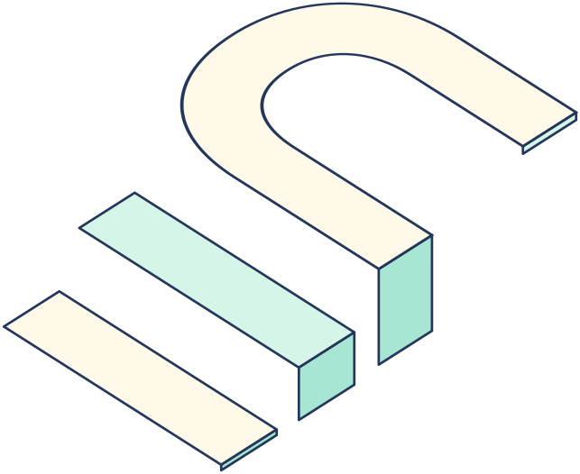
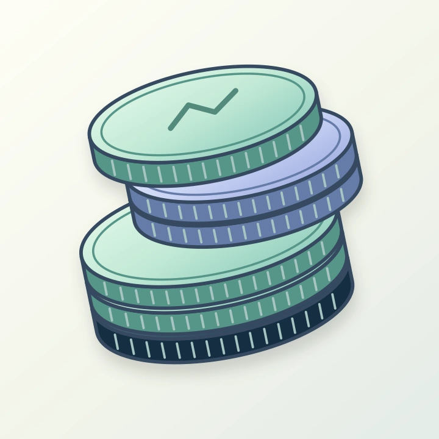
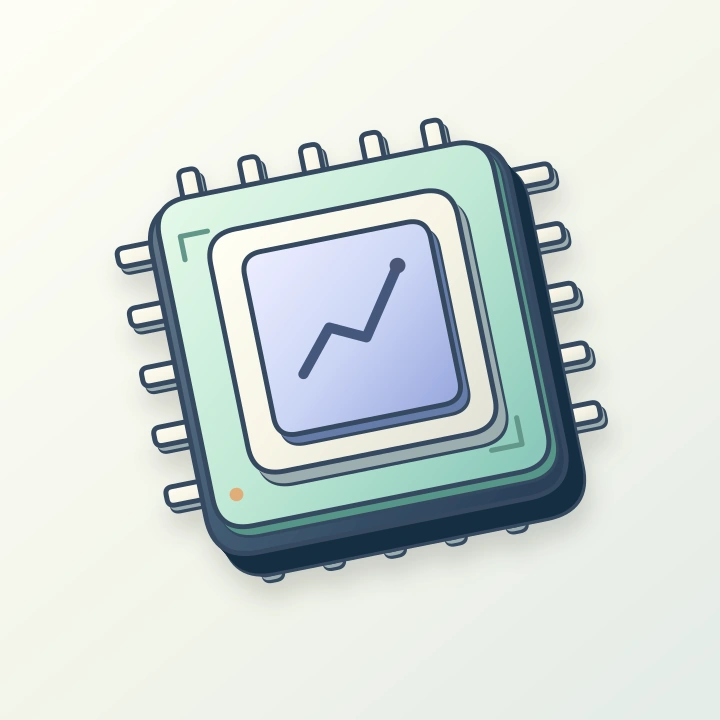
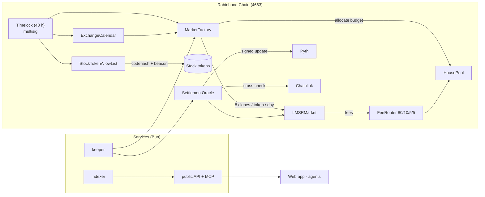

  

<h1 align="center">CLOSARI</h1>

  <b>Yes/no and range markets on where tokenized stocks close, on Robinhood Chain. 
  Settled automatically at the bell, in USDG.</b>

  
  
  
  

> [!IMPORTANT]
> Closari is in development. **Nothing is deployed**, no contract has had an external security review, and the
> figures below are design proposals that will change after the 30-day settlement replay. The website in this repo
> is a paper-trading preview with illustrative prices.

---

## What it is

Every trading day Closari lists a fresh set of markets on where the most liquid Robinhood Chain stock tokens will
close. Each market asks whether the token will close above or below a strike, inside a price range, or up or down on
the day. An always-on market maker quotes every market, so there is no order book to wait on. At the bell a
published formula settles each market from Pyth's public price feed, cross-checked against Chainlink's public feed.
Each winning share pays **1 USDG**.

| | |
|---|---|
| **Underlying** | Robinhood Chain stock tokens. Launch set: SPY, QQQ, NVDA, TSLA, AAPL, META, AMZN, MSFT, GOOGL, AMD, PLTR, MU |
| **Markets per day** | 8 per token (96 at launch): six strikes at ±1/2/5%, one five-bucket range ladder, one up/down |
| **Trading** | Around the clock from listing until **15:50 ET**, then a halt, then settlement at the **16:00 ET** bell |
| **Price** | Each outcome trades from 0.001 to 0.999 USDG. The price is the market's **implied chance** |
| **Settlement** | Formula only: no votes, no committees, no discretion |
| **Collateral** | USDG in, USDG out. Payouts are claim-based, so one frozen wallet never blocks anyone else |

##  Three market formats

**Close above a strike.** _"Will NVDA close above $190.00 today?"_ YES shows 0.62, so the market puts about a 62%
chance on YES. Buying 100 YES costs 62.41 USDG plus a 0.50% fee (62.72 USDG in total). If NVDA settles above
$190.00, the shares pay 100.00 USDG.

**A range ladder.** _"Where will TSLA close today?"_ Five buckets around the previous settlement price,
**under $392 · $392–$398 · $398–$402 · $402–$408 · $408 and over**, each opening at 0.20. The bucket the
settlement price lands in pays 1 USDG per share.

**Up or down on the day.** _"Will SPY close above its 09:30 ET price?"_ The opening reference is the first Pyth
regular-session price at 09:30:00 ET, recorded on-chain by anyone.

Strikes are quoted per **token**, which is what the chain's price feeds track. Tokens fold in dividends through a
multiplier, so they sit within about 0.2% of the share price, and the app shows the share-price equivalent next to
every strike.

##  A trading day

| Day D (Eastern Time) | What happens |
|---|---|
| After D−1 closes | Anyone can list day D: 8 markets per token, strikes centred on the last settlement price |
| Until 15:20 | Trading around the clock at the 0.50% base fee |
| 15:20 – 15:50 | The fee ramps up linearly, by up to an extra 2.50% |
| **15:50** | Trading halts |
| **16:00:00** | Pyth's signed price for the bell second is submitted (by the keeper, or by anyone for a bounty), followed by the Chainlink cross-check and the corporate-action check |
| Minutes later | Markets resolve or void, and winning shares become claimable at 1 USDG each |

**What "close" means here.** Closari's close is **its own settlement price**: the first Pyth regular-session price
published in the bell second, converted once into token terms. It is _not_ the exchange's closing-auction print,
and it can differ from the number quoted in the news, usually by a few basis points.

**When a market voids.** A market voids if the feed's confidence band is too wide, if a fresh Chainlink round
disagrees by more than 1%, if the price lands within the confidence band of a strike, if a corporate action touches
the token, or if no valid price arrives within two hours. On a void, every share redeems at its outcome's
**time-weighted price over the last 60 minutes of trading**, and **every fee paid in that market comes back**. This
is not "your cost back". It is the rule that can never cost the pool more than the budget it set aside.

##  The house pool and fees

Every market is funded by one **house pool** of USDG. When a market opens, the pool sets aside a **budget**, which
is the most that market can ever cost the pool. The market maker (a fixed-b logarithmic market scoring rule) caps
the loss at `b · ln(n)`, and Closari sets `b = budget ÷ ln(n)`. A yes/no market with a 2,000 USDG budget therefore
has b ≈ 2,885 shares and can lose at most 2,000 USDG, whatever traders do.

Liquidity providers deposit USDG for pool shares and carry the market-making risk. Pool shares can fall, and no rate
of growth is promised or shown.

| Fees (proposals) | |
|---|---|
| Base fee | 0.50% of trade value, on buys and sells |
| Late ramp | From 15:20 ET, rises linearly to an extra 2.50% at the halt |
| Hard caps in code | Base ≤ 2.00%, ramp ≤ 5.00% |
| On a void | All fees paid in that market are refunded |
| Fee split (fixed in code) | 80% house pool · 10% treasury · 5% settlement bounties · 5% builder rebates |

**$CLSR** is a utility token for access and fee discounts only (10 / 20 / 30% off the base fee). It is never a claim
on fees, revenue or pool assets, and it is never needed to trade.

##  Architecture

Design rules: no upgradeable contracts, no admin path to user funds, and every state change (listing, recording the
open, settling, claiming) is permissionless. The keeper is a convenience, not a dependency. Agents are first-class
users: a public API and an MCP server let them read markets, quote, build and relay trades, and claim, while signing
with their own keys.

## Roadmap

| Milestone | Scope | Status |
|---|---|---|
| **M1** | Monorepo, CI, `ExchangeCalendar`, `StockTokenAllowList`, `MarketFactory`, frozen interfaces, generated ABIs | ✅ built and reviewed |
| **M2** | `LMSRMarket` trading: math, rounding, fees and ramp, halt, gasless entry (EIP-3009, Permit2) | ✅ built, in review |
| M3 | `SettlementOracle`: Pyth tiers, Chainlink cross-check, voids, claims | |
| M4 | Keeper and Hermes fetcher | |
| M5 | Indexer and public API | |
| M6 | MCP server for agents | |
| M7 | `HousePool`, `FeeRouter`, `$CLSR` staking | |
| M8 | Security pass, 30-day settlement replay, external review, mainnet | |

Open design decisions are tracked in the
[M1 design spec](docs/superpowers/specs/2026-11-21-closari-monorepo-m1-design.md) under "Open decisions before M2/M7".

## Honest boundaries

- **Settlement is not the closing auction.** It is Pyth's price in the bell second, in token terms.
- **Closari depends on Pyth.** If Pyth publishes nothing usable near the bell, markets void. Chainlink's stock feeds
  update only on 0.5% moves, so at 16:00 the cross-check is often stale and Pyth alone governs.
- **The house pool can lose**, up to the full budget of every market on a given day.
- **USDG's issuer can freeze wallets and pause the token.** A frozen wallet waits; nobody else is affected.
- **Access is restricted.** The front end, API, MCP server and relayer block the United States, Canada, the United
  Kingdom, the EU/EEA and other restricted or sanctioned jurisdictions. Contracts cannot be geofenced, and legal risk
  is real.
- Closari is built on Pyth's and Chainlink's public price feeds. It has no partnership with, or endorsement from,
  Robinhood, Pyth, Chainlink or the USDG issuer.

---

## For developers

| Path | What |
|---|---|
| `apps/site` | The paper-trading website (React/Vite) |
| `contracts` | Foundry project (`@closari/contracts`) |
| `packages/core` | Generated ABIs, calendar and strike references (`@closari/core`) |
| `apps/{keeper,indexer,api,mcp,calendar,hermes}` | Services, from M4 on |
| `infra` | OVH VPS stack (Caddy now, services later); see `infra/README.md` |
| `docs/superpowers/specs` | Design spec, interface change log, cross-milestone obligations, open decisions |

Setup: Bun 1.4.2 (`.bun-version`), Foundry 1.8.1 (`.foundry-version`), Node 24.

    bun install --frozen-lockfile
    git submodule update --init --recursive
    bun run site:build && bun run site:preview      # http://127.0.0.1:4173/
    bun run contracts:test

Checks (as CI runs them):

    bun run lint && bun run typecheck && bun test scripts/checks packages
    bun run checks                                  # dependency pins, I11 multiplier rule, banned words
    bun run contracts:build && bun run abi:check

Fork tests run against Robinhood Chain (4663). `RPC_4663` defaults to the public RPC, which serves state only for
recent blocks, so `FORK_BLOCK` (a pinned block) needs an archive RPC; without it the tests run at `latest`.

    RPC_4663=<archive rpc> FORK_BLOCK=<block> bun run contracts:test:fork

Local deploy (anvil only; mocks are never deployed to 4663). The script refuses unless `CLOSARI_LOCAL_DEPLOY=true`
and the RPC is an anvil node (31337, or an anvil fork of 4663):

    anvil --port 8545                                              # or: anvil --fork-url "$RPC_4663" --port 8546
    cd contracts && CLOSARI_LOCAL_DEPLOY=true forge script script/DeployLocal.s.sol --rpc-url http://127.0.0.1:8545 --broadcast --sender 0xf39Fd6e51aad88F6F4ce6aB8827279cffFb92266 --private-key 0xac0974bec39a17e36ba4a6b4d238ff944bacb478cbed5efcae784d7bf4f2ff80

Frozen interfaces (`contracts/src/interfaces`, hashes in `contracts/interfaces.lock.json`): never edit an interface
without first appending an entry to the "Interface change log" in
`docs/superpowers/specs/2026-11-21-closari-monorepo-m1-design.md` (what changed, why, which milestones it affects).
Then rebuild and re-freeze:

    bun run contracts:build && bun run abi:write && bun run abi:freeze && bun run abi:check

Media masters (films, campaign, art sources) and internal working documents are kept outside this public repository.

**Licence:** not yet chosen (MIT or BUSL is an open decision); all source files are `UNLICENSED` until then.
